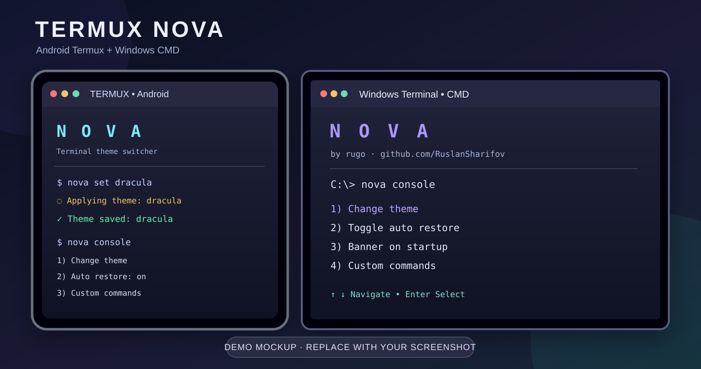

<div align="center">

# ✦ TERMUX NOVA ✦

**Android Termux & Windows CMD Theme Switcher / Command Manager**

**by [rugo · Ruslan Sharifov](https://github.com/RuslanSharifov)**



*Demo placeholder — one combined Android + PC preview, not a real screenshot. Later, upload your own image (for example `docs/assets/termux-cmd-demo.png`) and update the image link above.*

[📘 All setup languages](SETUP.md) · [🧩 Commands](#how-to-use-nova) · [🌍 Languages](#setup-in-6-languages)

</div>

---

## 🚀 Install — Android Termux

**Copy the entire block once and paste it into Termux.** The commands download the repo, install Nova, load the Bash hooks, and finish with `clear`.

```bash
pkg update -y && pkg install -y git && \
cd "$HOME" && \
git clone https://github.com/RuslanSharifov/termux-nova.git && \
cd termux-nova && \
bash install.sh && \
source "$HOME/.bashrc" && \
clear
```

✅ Done. Nova loads automatically in future interactive Bash sessions when the installer hooks are enabled. During installation, **read the prompts**: you can choose whether to disable other prompt customizations (with backups), and whether to enable automatic theme restoration (press **Enter** for yes).

> **Already cloned the repository?** The clone step will stop if `~/termux-nova` already exists. To update an existing install, use the commands in [Update](#update).

## 🖥️ Install — Windows CMD (no commands to copy)

1. **[Download termux-nova ZIP](https://github.com/RuslanSharifov/termux-nova/archive/refs/heads/main.zip).**
2. Extract the ZIP archive.
3. Open `termux-nova-main/windows/`.
4. **Double-click `install.cmd`.** Follow the installer prompts and open a new CMD window.

✅ Done. Open <strong>Command Prompt</strong> (not PowerShell) and type `nova console` to open settings. Windows Terminal is recommended for color themes.

> **Before installing on Windows:** The CMD installer modifies the per-user `Command Processor\AutoRun` registry setting to load banner and custom-command macros. If you already use CMD startup commands, back them up first. [Safe Windows installation and backup instructions](docs/cmd/SETUP.en.md).

## 🌍 Setup in 6 languages

Choose **your device first**, then your language. Each guide starts with the same quick install and explains themes, commands, updates, uninstall and troubleshooting afterward.

| Language | 🤖 Termux (Android) | 💻 Windows CMD |
|:--|:--|:--|
| 🇦🇿 Azərbaycan | [Termux](docs/termux/SETUP.az.md) | [Windows CMD](docs/cmd/SETUP.az.md) |
| 🇬🇧 English | [Termux](docs/termux/SETUP.en.md) | [Windows CMD](docs/cmd/SETUP.en.md) |
| 🇹🇷 Türkçe | [Termux](docs/termux/SETUP.tr.md) | [Windows CMD](docs/cmd/SETUP.tr.md) |
| 🇷🇺 Русский | [Termux](docs/termux/SETUP.ru.md) | [Windows CMD](docs/cmd/SETUP.ru.md) |
| 🇩🇪 Deutsch | [Termux](docs/termux/SETUP.de.md) | [Windows CMD](docs/cmd/SETUP.de.md) |
| 🇫🇷 Français | [Termux](docs/termux/SETUP.fr.md) | [Windows CMD](docs/cmd/SETUP.fr.md) |

[All setup guides and language selection](SETUP.md)

## ✨ Features

- **Editable block-art startup banner**: replace the large NOVA lettering with your own text, numbers or symbols; original NOVA remains the default.
- **Large NOVA startup banner**, GitHub project information and an animated theme loader.
- **Theme switching**: `nova-dark`, `dracula`, `nord`, `gruvbox`.
- **Saved settings / auto restore**: run `nova auto on` to reapply your choice on new sessions.
- **Settings menu**: `nova console` (numbered controls; on Windows also arrows + Enter).
- **Custom command shortcuts**: create, view, edit or delete commands with multiple steps.
- **Theme files**: `themes/*.properties` for Termux and `windows/themes.json` for Windows Terminal.
- **No root required** on Android.

*What Nova changes:* terminal colors, interactive Bash/CMD startup banner and command shortcuts — **not** Android's native app menus or the Windows desktop. This version does not yet implement ghost-text history suggestions, Tab acceptance or SQLite command counters.

## 🎛️ How to use Nova

After installation, open a new Termux or **CMD** session:

```text
nova console
nova list
nova set dracula
nova current
nova auto on
nova auto off
nova banner
nova doctor
nova help
```

| Command | Purpose |
|---|---|
| `nova console` | Open settings panel |
| `nova list` | See available themes |
| `nova set dracula` | Change and save theme |
| `nova current` | Display saved settings |
| `nova auto on` / `nova auto off` | Toggle automatic theme restoration |
| `nova banner` | Show the banner |
| `nova banner set "Hello!"` | Save a custom block-art banner text |
| `nova banner reset` | Restore the original NOVA art |
| `nova cmd` | List custom commands |
| `nova cmd add "trigger" "steps"` | Create a shortcut |
| `nova cmd edit "trigger" "steps"` | Edit a shortcut |
| `nova cmd rm "trigger"` | Delete a shortcut |
| `nova cache clear` | Clear Nova's cache |
| `nova hook` | Reinstall startup integration |
| `nova doctor` | Diagnose integration |

### ✍️ Customize the big NOVA banner

The large cyan **NOVA** lettering can now be replaced with your own message on both Android Termux and Windows CMD.

1. Run `nova console`.
2. Choose **Change banner text** (Termux) or **Banner text** (Windows).
3. Type your message and press Enter. The banner updates and remains saved for future sessions.
4. Leave the input empty to reset to the original **NOVA** lettering.

You can also change it directly:

```bash
nova banner set "RUSLAN 2026!"
nova banner
nova banner reset
```

The shared 8×8 block font includes **all 95 printable ASCII characters** (A–Z, a–z, 0–9, punctuation), Latin-1 accented letters, Greek characters, Azerbaijani/Turkish characters, Cyrillic letter approximations and several extra symbols. Unsupported characters display as `?`. Text is limited to 64 characters and wraps to fit the terminal. Settings are stored locally; this does **not** rename the GitHub project or change the attribution.

The font atlas is [`assets/banner-font.txt`](assets/banner-font.txt). The base glyphs come from the [public-domain font8x8 project](https://github.com/dhepper/font8x8).

### Custom commands (CRUD)

Example: inside a Node.js project, create a shortcut for installing dependencies and starting development:

```bash
nova cmd add "npm run full" "npm install /// npm run dev"
nova cmd
nova cmd edit "npm run full" "npm install /// npm run build"
nova cmd rm "npm run full"
```

`///` joins steps sequentially (only continue when the previous step succeeds). Requires Node.js/npm and a suitable `package.json`.

After editing shortcuts, start a **new CMD window** on Windows; on Termux, open a new Bash session or run `source ~/.bashrc`. Avoid putting passwords, tokens or untrusted scripts into saved commands.

## 🔄 Update

**Termux (already installed):**

```bash
cd ~/termux-nova && git pull --ff-only && bash install.sh && source ~/.bashrc && clear
```

**Windows:** download the latest ZIP again, extract it, and double-click `windows/install.cmd` in the new folder. The installer can update the installed files.

## 🛠️ Help, safety and removal

- **Termux:** `nova doctor` checks the hooks. The installer may comment out competing prompt configuration in rc files, after creating backups. `nova restore` restores the latest `.bashrc` backup but can overwrite later changes.
- **Windows:** use Windows Terminal with a **Command Prompt** profile to apply themes and CMD macros. The installer uses `HKCU\Software\Microsoft\Command Processor\AutoRun`; preserve an existing value before installation. Windows Terminal `settings.json` may also be changed.
- **Uninstall:** see [Termux instructions](docs/termux/SETUP.en.md) or [Windows CMD instructions](docs/cmd/SETUP.en.md). Back up custom shortcuts before removing their storage files.

## 📂 Project files

```text
termux-nova/
├── README.md
├── SETUP.md
├── docs/
│   ├── assets/termux-cmd-demo.svg      # Replaceable combined demo image
│   ├── termux/SETUP.{az,en,tr,ru,de,fr}.md
│   └── cmd/SETUP.{az,en,tr,ru,de,fr}.md
├── assets/banner-font.txt               # Shared block glyph atlas
├── install.sh                           # Termux installer
├── nova.sh                              # Termux CLI
├── themes/                              # Android themes
└── windows/
    ├── install.cmd                      # Windows: double-click
    ├── install.ps1
    ├── nova.ps1
    ├── nova.cmd
    └── themes.json
```

---

**Made by rugo · [Ruslan Sharifov](https://github.com/RuslanSharifov)** · [MIT License](LICENSE.md)

*Enjoy your terminal. ✦*
